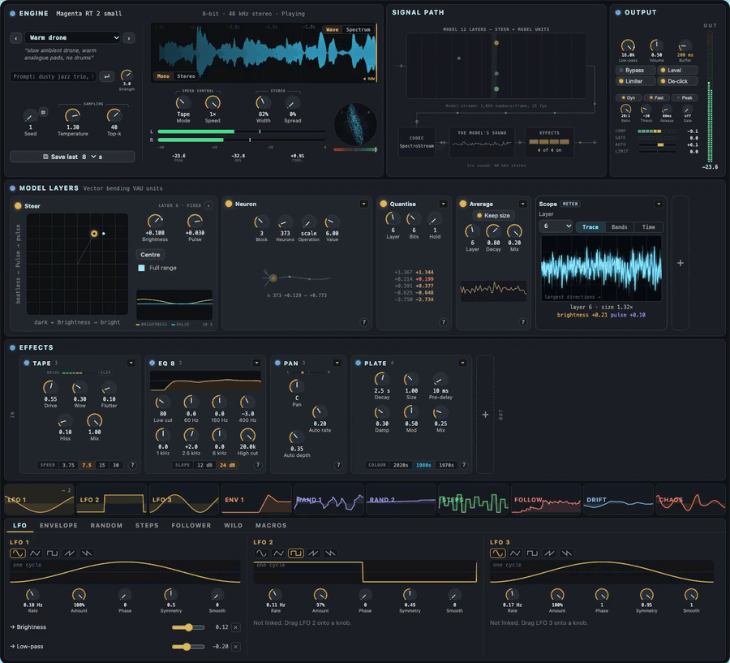
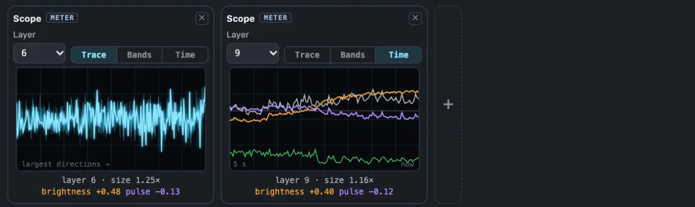
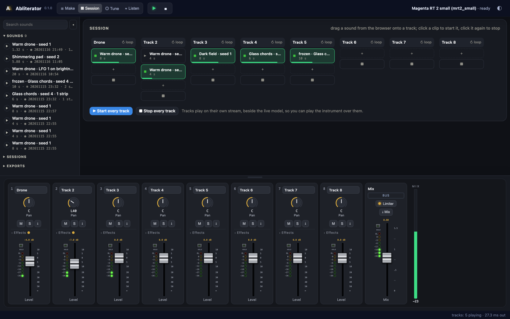
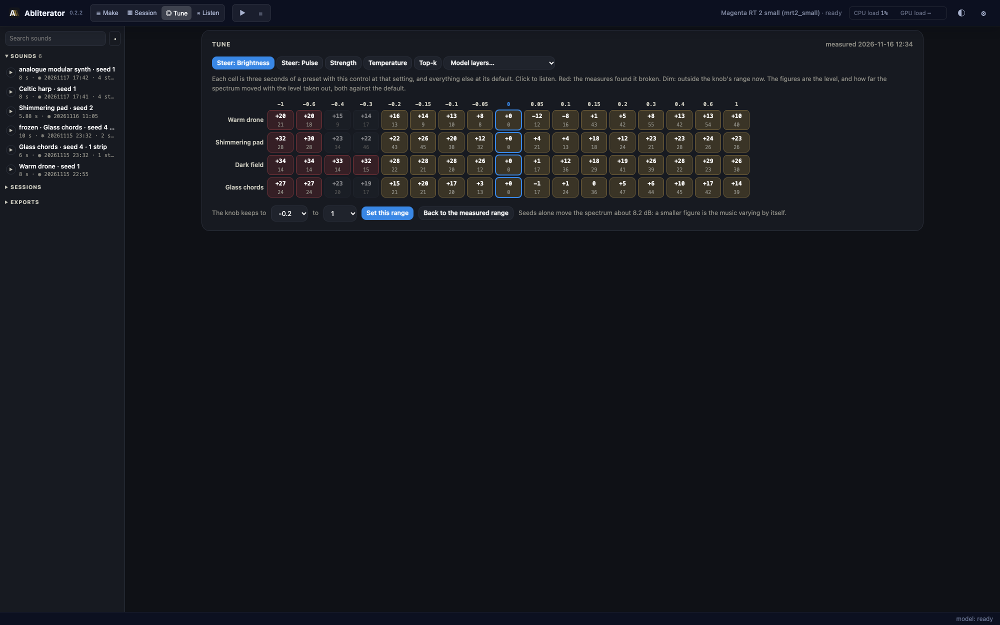

> Part of the [Vector Lab](https://github.com/vector-lab-tools). Vector methods for vector theory.
> [Overview and map](https://vector-lab-tools.github.io) · [Org profile](https://github.com/vector-lab-tools)
>
> **Tier:** instrument. **Object:** vector bending of a music model's forward pass, while it plays.
>
> **Units:** [Vector Abliteration Units](https://vector-lab-tools.github.io/vector-abliteration-units/) (VAU).
>
> **Site:** [vector-lab-tools.github.io/abliterator](https://vector-lab-tools.github.io/abliterator/): sounds to listen to, how it works, and the knob that plays the real sweep. [Model layers](https://vector-lab-tools.github.io/abliterator/units.html): where the VAU units live and act, unit by unit. [Tech specs](https://vector-lab-tools.github.io/abliterator/tech-specs.html): how it is built, and a deep dive into every unit and what it does to the sound.

<p align="center"></p>

<h1 align="center">Abliterator</h1>
<p align="center">Vector bending for a music model, played live<br>
<sub>A Vector Lab tool · alpha · GPL-3.0-or-later</sub></p>
<p align="center"><b><a href="https://vector-lab-tools.github.io/abliterator/">Website: vector-lab-tools.github.io/abliterator</a></b></p>
<p align="center"><a href="https://zenodo.org/badge/latestdoi/1460113472"></a></p>

---

**Author:** David M. Berry
**Institution:** University of Sussex
**Version:** 0.3.1
**Status:** alpha
**Licence:** GPL-3.0-or-later
**DOI:** [10.5281/zenodo.24517766](https://doi.org/10.5281/zenodo.24517766)
**Website:** https://vector-lab-tools.github.io/abliterator/

Abliterator plays a music model on your own machine and changes how it runs while it plays. The model writes a frame of stereo audio at each step from a style prompt and a seed. The default engine is [Magenta RealTime 2](https://github.com/magenta/magenta-realtime) small (a 40 ms frame of 48 kHz stereo per step); MusicGen small is a second engine, and other models can be added behind the same engine interface. **Steer** adds a direction to its residual stream (brighter or darker, more pulse or beatless) on an XY pad; **Model layers** puts [Vector Abliteration Units](https://github.com/vector-lab-tools/vector-abliteration-units) between its twelve transformer layers. After the model come auto level, an **effect chain** of up to eight, **Dynamics** (a compressor and gate), stereo **Width**, a low-pass, a limiter and a volume, and twelve **modulation** sources move the knobs while it plays. A move is heard about 130 ms after it is made. Sounds are saved as heard, with a recipe that replays them exactly, and layered on eight tracks in **Session**.

<p align="center"></p>

<p align="center"></p>

## What it does

- **Synth.** The instrument as a synth panel, on one laptop screen: the Engine (model; twenty-five presets in six groups, from ambient and electronic to acoustic, orchestral and experimental, or a style typed in the Prompt box and kept under Your prompts; Strength, how strongly the prompt steers the music; Seed; Temperature and Top-k under SAMPLING; and a scope of the last three seconds), the Signal path, the Output section, Model layers (Steer first, fixed at layer 6, then the units), Effects and Modulation. The Signal path draws, live, the stream through the model's twelve layers with Steer and each unit marked where it acts and lit while it acts, the codec, the model's sound and the effects, and an arrow on to the Output panel beside it, with dots running along both paths while it plays; a stage scrolls to its panel when clicked. Every knob sends while it turns; the change is heard from the next frame. **Speed** plays the model's sound slower, down to ⅛×, and **Mode** sets how: Tape lets the pitch fall with it, Stretch keeps the pitch (a phase vocoder with identity phase locking), Smear keeps it and washes it out over 0.34 s windows (after Paulstretch), and Off plays at 1× and keeps Speed's setting. The model writes only as fast as its sound is used, and a saved sound replays its speed exactly. Under the Engine's scope (Wave or Spectrum, with Mono and Stereo in its corner) are Mode and Speed under a SPEED CONTROL bracket and Width and Spread under STEREO, then left and right peak meters with the peak, RMS and correlation, and beside them the stereo field; the top bar shows CPU load and GPU load (the slowest steps against the 40 ms frame), and at its right a Volume dial, the same as the Output panel's, and a small output level meter, both always in view. The theme (system, light or dark) is in Settings, Display.
- **Steer.** Directions made by difference of means from pairs of prompts that differ in one quality, kept as editable Markdown in `backend/config/contrasts/`. Brightness and Pulse ship. A dose is a share of the stream's typical size, added at layer 6.
- **Model layers.** VAU units placed between the transformer layers (drag a card by its name to change their order; units at the same layer act in that order), under VAU's names for what they do to the stream (VAU marks its Core units as vector effects with a small v, which the units' help shows): Lookback, Running Average, Frame Repeat (VAU's Position Repeat), Tanh Squash, Norm Shrink, Band Shrink, Component Clamp, Principal Bands, Quantise, Sparsify, Rotate, Abliterate and Neuron. The units' PyTorch code runs on the MLX model through a bridge that hands each unit the stream at its layer for the position being written; each crossing makes the GPU wait for the CPU. Neuron, Quantise and Abliterate run instead as MLX versions of the same arithmetic (`mlxunits.py`, tested against VAU's units), so they stay on the GPU: Neuron in all twelve blocks adds under 1 ms to a step, where the bridge added about 9 ms, and Abliterate on all blocks no longer stalls each step 24 times. Abliterate's Strength runs to 6 here (VAU stops at 1.5): above 1 the direction is turned round rather than removed. Every card has a ▾ menu by its name. It lists the unit's presets, five to seven for each unit (`data/presets/mrt2_small.json`; Abliterate's are by strength: Remove · 1, Mirror · 2, Beyond · 4, Far side · 6, and VAU's own Late blocks). Each unit preset was chosen from a search over six seeds of the Warm drone and kept only if it broke the sound on none of ten other seeds; its tip says which way the sound moved on those seeds beyond chance. Under User Presets are presets of your own: type a name in Save preset… and Save keeps the card's settings (in `data/my_presets.json`, on every card of that unit), and × deletes one. A long list scrolls, with a Find box. The same menu holds Snap-back and Remove; a card clicked is selected, and Delete or Backspace removes it. Effect cards have the same menu, with five to seven presets for each effect (`data/presets/fx.json`, 159 in all), each run offline over eleven inputs (drones, a harp, a modular synth and a drum loop) and kept only if it broke none and changed every one measurably. Defaults changed where measurement found the old ones unheard or breaking ([Tech specs](https://vector-lab-tools.github.io/abliterator/tech-specs.html) has the figures): Lookback starts as Feedback Loop and Running Average as Long Tail (both with Keep size, now a switch on their cards), Component Clamp at layer 10, Quantise at 1 bit, Band Shrink on the low band at 20:1, and Neuron on 32 neurons of block 10 chosen for Brightness, held at 8. Abliterate's Bias too is not shown, since on this model it changes nothing, nor are the Sink too switches of Sparsify and Component Clamp: Magenta RT 2 has no attention sink, so every unit bends a take's first frame like any other (VAU 0.3), and Abliterate's Peak, Width and Edge are dimmed while its Shape is flat. Snap-back is on by default: the model reads back about 20 s of its own frames, so a unit's sound lingers after it goes off, and with snap-back the model returns at once to its state when the unit went on. A unit that cannot attach reports why on its card and leaves the others playing. While it plays, each card shows what its unit is doing from the engine's readings at its layer (32 of the stream's values going in and coming out, and the stream's size after against before): Quantise and Component Clamp list values in and out; Sparsify draws its values as pixels, the zeroed ones dark; Tanh Squash plots out against in; Running Average traces one value before and after; Norm Shrink, Band Shrink and Principal Bands light gain LEDs; Lookback lights its taps on a row of frames; Frame Repeat lights where it repeats; Rotate runs a point along its angle; Neuron draws the neuron it changes most, swelling and firing with its value. Units without a display of their own have a green light that breathes while they act. Layer, Block, Neurons and the longer menus are stepped knobs; short menus are buttons, and a unit's Direction is a row of buttons, one for each direction, the chosen one lit. Space plays and stops.
- **Grouped by what they act on.** The add menu lists the units under Along time, On the stream's size, Coordinate by coordinate, Along directions and principal bands, and Inside a block. The space each acts on is read from the unit's manifest where it declares one, and from this host's own reading otherwise.
- **Order on the row.** The order of the cards matters only among units on the same layer. Each unit acts at its own layer or block, wherever its card sits: Lookback at layer 6 and Tanh Squash at layer 10 do the same in either order. Units on the same layer run left to right, and at layer 6 after Steer. Where their edits do not commute, the order changes the sound: Tanh Squash then Norm Shrink is not Norm Shrink then Tanh Squash, and even two Principal Bands cards, which commute in exact arithmetic, give a different take in each order, since the stream is rounded to bfloat16 after each unit. Lookback and Running Average record the stream as it reaches them: a unit before them on that layer goes into what they repeat, and a unit after them acts on their output, echo included, without being repeated. Neuron and Abliterate act inside the blocks, so their place among the stream units makes no difference. Measured on seven pairs over ten seeds ([Tech specs](https://vector-lab-tools.github.io/abliterator/tech-specs.html#order-on-the-row)), the two orders on a shared layer never gave the same audio, and three of the five pairs moved level, brightness or spectral shape the same way on most seeds; on different layers the audio was identical.
- **Scope.** A meter on the Model layers row (up to four) that reads the stream at its layer each frame, after the Steer and the units there, and changes nothing. Trace draws the stream along its principal directions, largest first; Bands shows how far it swings in bands of those directions against its ordinary level; Time scrolls five seconds of its size, its reading along each Steer direction on the dose's own scale, and how far it turns from one frame to the next. Scopes are not saved with sounds.
- **Listen.** A view (≋) that shows what you hear as a spectrogram while it plays: the model after its effects and output section on one lane, the tracks' mix on another, 40 Hz to 20 kHz over the last ten seconds, in the website's colours and scale. The Engine panel's scope switches between the waveform and the same spectrogram.
- **Output.** Auto level, Dynamics (ratio, threshold, release and a gate, with Fast attack and Peak detection, and LEDs for each one's reduction), Width and Spread on the stereo field, a low-pass, a limiter and a volume; Bypass skips them all. De-click, first in the chain and on by default, redraws the few-sample bursts a unit pushed hard can make the model write (1.3 ms look-ahead). The OUT meter lights in cells with a hold line on each channel's peak. When the model falls behind, the last block plays on mirrored and fades over 30 ms, and the audio crossfades back in, so a dropout makes no click.
- **Effects.** A chain of up to eight after the model, in one row from IN to OUT that scrolls sideways, added with a + in any gap and dragged into order, with a light that bypasses the chain; each one of reverb (a feedback delay network), plate (Dattorro's 1997 plate tank, with modulated allpasses), hall (a larger feedback delay network whose delay times wander smoothly at random; Plate and Hall each have a Colour of 2020s, 1980s or 1970s: clean, a darker tank with noisier modulation, or a tank run at half rate behind a 10 kHz band limit), delay (with ping-pong), chorus, drive, tape (saturation gain-matched at the model's usual level, wow and flutter, a head bump and roll-off by tape speed, hiss), pan (equal-power, with an auto-pan), a three-band EQ, EQ 8 (a low cut, six bells and a high cut, the cuts 12 or 24 dB an octave), filter, crush, Abliterated (heavy distortion: two lopsided clipping stages driven up to +50 dB by Crunch, a wavefolder by Edge, an octave and a ring modulator by Complicate, aimed by Steer, with a cabinet low-pass and a make-up gain that holds the level), phaser (4, 8 or 12 swept allpasses, with feedback), flanger (a swept 0.3 to 20 ms delay, feedback either sign), tremolo (sine, triangle or soft square, the sides in or out of phase), compressor (feed-forward, stereo-linked, soft knee, parallel mix), resonator (tuned combs at a root note and a chord), freq shift (single-sideband, up or down by up to 1 kHz, with spread and feedback), pitch (a two-head delay-line shifter, ±24 semitones, with feedback), shimmer (a reverb whose tail is pitch-shifted on each pass), freeze (a spectral hold of the moment it is switched on), trim (gain, balance, width from mono to 400%, a phase flip on each side, one side on both or the two swapped, bass mono, a mono check and a DC filter), or de-click (the output section's de-click, placed where you want it), written in numpy and scipy so that the output is the same at any block size. A change to the chain dips the output for a moment (about 16 dB, back up over 150 ms), switching an effect on or off crossfades it, and a delay or reverb whose delay time or size changes fades its wet signal out and back, so none of them clicks. Filter and the EQs draw their response curves; Drive has a small meter of how hard its curve is driven, with a CLIP mark; De-click counts the bursts it has redrawn.
- **Modulation.** Three LFOs, three envelopes, two random sources, Steps (a drawn sequence), the Follower (the sound's own loudness), Drift and Chaos (on the Wild tab), and four macros (a macro's tile, and ENV 2 and 3, show once they move something). Drag a source onto any knob that takes one: the Steer doses, Strength, Temperature, the low-pass, the volume, and every knob of a Model layers unit or an effect. With a source selected, each knob it can move shows its send: drag up for more, down for less, double-click to unlink. An LFO's Amount scales every send from it. A modulated unit is attached again with its memory kept whenever its knob moves a step. Sources are functions of the frame's time, so a saved sound replays its modulation exactly.
- **Musical knobs.** Every control and every unit setting was swept on several presets and each render measured (level, clipping, silence, centroid, flatness, a long-term spectrum, flux), against the spread that changing the seed alone gives. Each knob keeps to the measured safe range, and its travel is shaped toward where the sound changes. The ranges were measured on the four ambient presets; the other presets and typed styles use them until a Tune pass is run on them. **Tune** lays the sweeps out as a grid of clips, and a range can be set by ear there.
- **Sounds and Session.** **Save last** keeps the last 4 to 60 seconds as heard, with a recipe from which the engine renders it again sample for sample. Session has eight tracks of saved sounds that loop or play once, each a channel strip with pan, mute, solo, effects, and a fader with a ladder of LEDs and Hold reading the track's peak; a limiter on the mix, and exports of a track or the mix.
- **Two engines.** Magenta RT 2 small (MLX, Apple silicon) is the live engine. MusicGen small (PyTorch) is kept as a second engine with Steer and no model-layer units; it answers in about 285 ms. The model is chosen in Settings (⚙), Model, which the model's name in the Engine panel's header also opens.

<p align="center"></p>

The [Model layers page](https://vector-lab-tools.github.io/abliterator/units.html) shows where the units' code lives (the PyTorch units in the VAU package; the host and MLX versions of three units in this repository), where each acts inside the model, and for each unit a drawing of what it does and its whole measured sweep to listen to.

<p align="center">
<a href="docs/img/session.png"></a>
<a href="docs/img/tune.png"></a>
</p>

## Installing

Requirements: a Mac with Apple silicon (Magenta RT 2 runs on MLX), Python 3.12, and [uv](https://github.com/astral-sh/uv) or pip. The model's weights (about 2.9 GB) are not in this repository; `magenta-rt` keeps them in `$MAGENTA_HOME`, by default `~/Documents/Magenta`.

```bash
./setup.sh --mrt2
```

```bash
./launch.sh
```

`setup.sh` makes `.venv` for the server and, with `--mrt2`, `.venv-mrt2` for the engine, which installs `magenta-rt`, MLX and the `vau` package. `launch.sh` starts the server on `http://127.0.0.1:8775/` and opens the page. The server listens on this machine only and refuses writes without its own header. Sound goes to the default output device; the page is a control surface and plays nothing itself.

Tests:

```bash
.venv/bin/python -m pytest -q
```

```bash
.venv-mrt2/bin/python -m pytest -q tests/test_mrt2.py tests/test_mlxunits.py
```

## How it is built

A Python backend (FastAPI) holds the desk and talks to the engine, which runs in its own process (`mrt2_proc.py`) and takes JSON lines on its standard input. The page is plain HTML and JavaScript with no build step.

| Path | What it holds |
|---|---|
| `backend/abliterator/mrt2_proc.py` | The Magenta RT 2 engine: the step loop, Steer, the units' bridge, modulation per frame, renders and snapshots |
| `backend/abliterator/units.py` | The VAU units on this host: names, the space each acts on, host defaults, measured defaults and placements |
| `backend/abliterator/speed.py` | Speed: Tape, Stretch and Smear, between the model and the output section, replayed exactly offline |
| `backend/abliterator/engine.py`, `musicgen.py`, `codec.py` | The MusicGen engine: generation frame by frame, its EnCodec decoder, playback |
| `backend/abliterator/spectro.py` | The spectrogram of what is heard, from the sound-card callbacks, for Listen and the Engine scope |
| `backend/abliterator/scope.py` | The scope: what it reads from the stream at a layer, and what it keeps for the page |
| `backend/abliterator/mod.py` | Modulation sources, routes and the calibrated curves they move along |
| `data/presets/mrt2_small.json`, `data/presets/fx.json` | The units' and the effects' presets, with the figures each was chosen on |
| `backend/abliterator/mypresets.py` | Presets of your own, kept in `data/my_presets.json` |
| `backend/abliterator/mlxunits.py` | Neuron, Quantise (VAU's Erosion) and Abliterate in MLX, swapped in for their PyTorch hooks |
| `backend/abliterator/dsp.py`, `postfx.py` | The output section: de-click, auto level, the effect chain, dynamics, width, low-pass, limiter, volume, and the dropout cover |
| `backend/abliterator/desk.py`, `library.py` | Session's tracks and mixer; the sound library |
| `backend/abliterator/measure.py`, `calibrate.py` | The measures of a render and the calibration built from the sweeps |
| `backend/abliterator/directions.py` | Directions from contrast sets |
| `bench/` | Benchmarks, the sweeps (`sweep.py`, `sweep_units.py`) and the site's sound examples (`site_media.py`) |
| `data/calibration/mrt2_small.json` | The calibration the knobs use; remake it with the sweeps and `python -m abliterator.calibrate` |
| `web/` | The page |
| `docs/` | The website: the instrument, the Model layers page on the units, and Tech specs |

## Credits

- **Terence Broad.** The instrument took shape after his Sussex AI seminar, "Expanding the generative space", at the University of Sussex on 14 October 2026. His network bending and active divergence (Broad, Berns, Colton and Grierson 2021, [arXiv:2107.05599](https://arxiv.org/abs/2107.05599); Broad, Leymarie and Grierson 2021, [arXiv:2005.12420](https://arxiv.org/abs/2005.12420)) are what the Model layers do to a music model.
- **Magenta RealTime 2**, by Google DeepMind's Magenta team (weights CC-BY 4.0, code Apache-2.0), used through the `magenta-rt` package. Its weights are not redistributed here.
- **MusicGen small**, Meta's (weights CC-BY-NC 4.0), through Hugging Face Transformers. It is downloaded to the machine and not redistributed.
- **Paulstretch**, by Paul Nasca, for Smear; Laroche and Dolson's phase locking for Stretch. The code is this project's.
- **Signalsmith Audio**'s "Let's write a reverb", for the design of the reverb. The code is this project's.
- **Arturia's MiniFreak**, whose knobs keep to musical regions, for the idea behind the calibrated curves; **Ableton Live**, for Session and the layout. Abliterator is not affiliated with either company.

## Licence

Copyright (C) 2026 David M. Berry. Abliterator is free software: you can redistribute it and modify it under the terms of the GNU General Public License as published by the Free Software Foundation, either version 3 of the License, or (at your option) any later version. See `LICENSE`.
